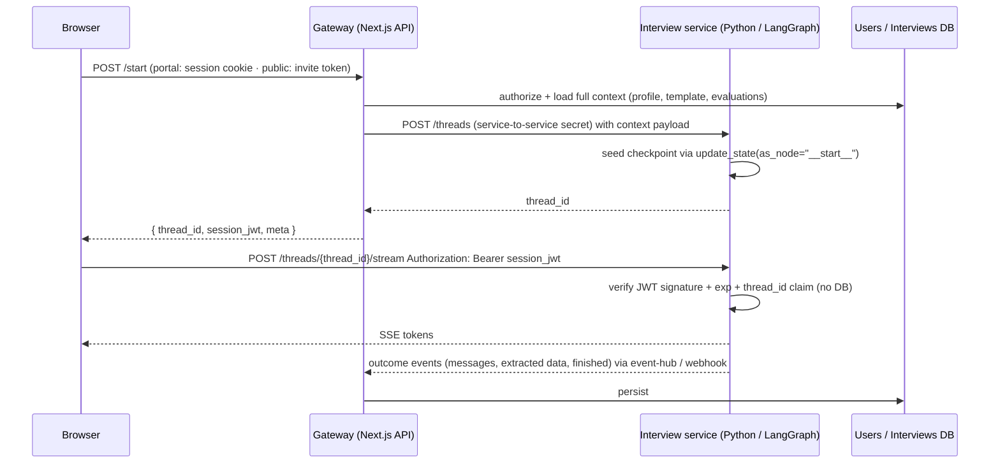

# Interview Session Design: Unified Start + Direct Streaming

This document describes how a candidate starts and streams an AI interview. It covers two
front doors — an authenticated portal candidate and a public candidate holding a single
invite URL — with one shared mechanism for context seeding, authorization, and streaming.

## Goals

- One streaming path for both portal and public candidates.
- The graph never accesses the users/interviews database.
- Full interview context is loaded into the graph before the first token is generated.
- No credentials stored in graph state; no cookies on the streaming connection.
- Next.js is removed from the long-lived streaming path.

## Components

| Component | Responsibility |
|---|---|
| Browser (lander / portal UI) | Calls `POST /start`, then streams directly from the interview service using a bearer token. |
| Gateway (Next.js API routes) | Identifies the candidate, authorizes, loads context from the DB, asks the interview service to create and seed a thread, mints a session token. |
| Interview service (Python / LangGraph) | Creates and seeds threads (service-to-service only), verifies session tokens statelessly, runs the graph, streams SSE, emits outcome events. |
| Event consumer (`apps/backend`) | Persists graph outcomes (messages, extracted data, status) to the DB. |

## Sequence



## Rules

1. **The gateway does all DB work, up front.** Authentication, ownership checks, invite
   validation, and context loading happen in Next.js before the thread exists. The graph
   receives a complete context payload and never queries users or interviews.
2. **Graph state holds context only, never credentials.** Nothing in the checkpoint is
   secret, so traces, state snapshots, and the state schema stay clean.
3. **One short-lived signed token for streaming.** Claims: `{ sub, interview_id, thread_id,
   exp, jti }`. HS256 with a secret shared between the gateway and the interview service.
   The service verifies statelessly and checks that the `thread_id` in the URL matches the
   claim. `exp` = expected interview duration + margin. The same token is reused for
   follow-up turns and reconnects.
4. **No cookies on the stream.** The browser sends the token via `fetchEventSource` in the
   `Authorization` header. No `SameSite` decisions, no CSRF surface, multiple tabs work,
   and it works across hosts.
5. **Thread creation and seeding are gateway → service only**, authenticated with a
   service-to-service secret. The browser can never create or seed a thread; it can only
   stream a thread it was issued a token for.
6. **Graph outcomes flow back as events, not DB writes from the graph.** The service emits
   `interview.message`, `interview.extracted_data`, and `interview.finished`; the existing
   event-hub consumer persists them. This replaces the current stream wrapping and status
   updates in the Next.js route.
7. **The service enforces one active run per thread** (409 on a concurrent stream), plus
   per-`sub` rate limits, max turns, and max message size.

## Where the two cases differ

| | Portal candidate | Public candidate |
|---|---|---|
| Identify | Supabase session → `userId`; check `row.userId === userId` | `sha256(inviteToken)` lookup; check `expires_at`, `status`, lock to first session |
| `sub` claim | `user:<userId>` | `invite:<inviteId>` |
| Context source | User profile + assigned interview | Recruiter-provided template + optional candidate fields |

Everything after `POST /start` returns is identical.

## Public invite links

- Token: ≥128 bits of randomness, opaque, carried in the URL path (`/i/<token>`).
- Storage: only `sha256(token)` is stored, alongside `recruiter_id`, template, `expires_at`,
  `status`, `thread_id`, `max_turns`.
- Lifecycle: expiring; revocable and regenerable by the recruiter; locked to the first
  session that opens it (later opens receive "already in progress").
- Abuse controls: a bot check (e.g. Turnstile) on the public lander; per-invite rate limit;
  max turns.

## Endpoints

### Gateway (Next.js)

- `POST /api/interviews/{interviewId}/start` — portal. Requires a Supabase session.
- `POST /api/public-interviews/start` — public. Body: `{ inviteToken }`.

Both return:

```json
{ "thread_id": "...", "session_jwt": "...", "meta": { "title": "...", "subtitle": "...", "templateKey": "..." } }
```

### Interview service (Python)

- `POST /threads` — service-to-service only. Body: full context payload. Creates the thread,
  seeds state via `update_state(as_node="__start__")`, returns `thread_id`.
- `POST /threads/{thread_id}/stream` — bearer `session_jwt`. Resumes the graph with
  `astream_events(None, config)` and streams SSE. Body (optional): `{ message }` for
  follow-up turns.

## Failure handling

| Condition | Response |
|---|---|
| Missing / invalid / expired token | 401, before any graph work |
| `thread_id` in URL ≠ claim | 403 |
| Concurrent stream on the same thread | 409 |
| Stream drops mid-generation | Client reconnects with the same token; service either resumes or returns 409 if the run is still active |

## What this removes

- Next.js in the streaming path: the gRPC proxy, SSE re-encoding, and stream wrapping.
- The start route shrinks to: identify → load context → seed → mint token.
- Bespoke hash-in-checkpoint auth, the cookie pair, and `SameSite=None`.

## What this does not remove

Persisting interview outcomes still has to exist; it moves from the Next.js stream wrapper
to the event consumer. That migration is the main cost of this design — the auth change is
small by comparison.

## Threat model

| Threat | Control |
|---|---|
| Candidate A streams candidate B's thread | Token bound to `thread_id` and `sub`; ownership checked at `/start` |
| Leaked or forwarded invite link | Expiry, lock to first session, recruiter revocation |
| Cross-site page triggers inference (CSRF) | No cookies on the stream; bearer header only |
| Scraped public link burns LLM budget | Bot check, per-invite rate limit, max turns |
| Checkpoint / trace exposure | No secrets in graph state |
| DB leak exposes live invite links | Only hashes stored |
| Browser creates or seeds arbitrary threads | Seeding is service-to-service only |